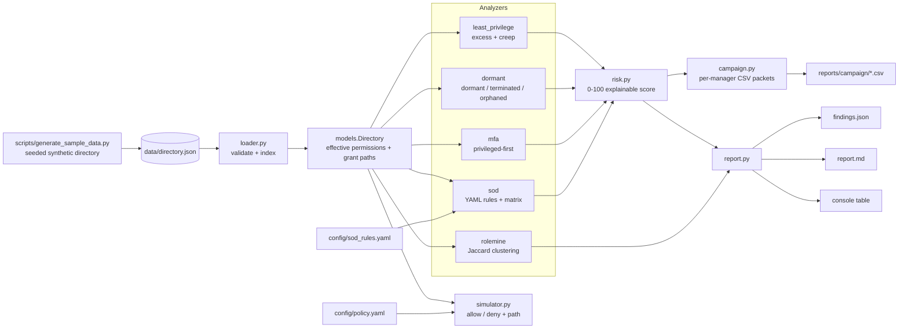

# IAM Access Governance Toolkit

**Audit an identity directory export for least-privilege violations, privilege creep, dormant and orphaned accounts, missing MFA and separation-of-duties conflicts - then turn the findings into risk scores and manager-ready access-review packets.**


## Why this project exists

Most breaches that make the news are not zero-days; they are *valid credentials* used by someone who should not have had them: a terminated contractor whose account was never disabled, an admin without MFA, a finance clerk who accumulated both "create vendor" and "approve payment" through three job changes. SOC and IAM analysts spend a large share of their time proving that access is appropriate - for auditors, for SOX/PCI controls, and for their own detection baselines. This toolkit automates the evidence-gathering half of that job: it ingests a directory export, runs a battery of governance checks, explains every finding with the exact grant path, and produces the CSV packets a manager needs to attest or revoke access.

## What it demonstrates

- Modelling RBAC the way real directories work: user -> group -> role -> permission, with direct grants and provenance tracked for every entitlement.
- Least-privilege analysis against a per-title baseline, with **privilege creep** attributed to the specific former job title that explains it.
- Lifecycle hygiene checks: dormant (>90 days), never-logged-in, terminated-but-enabled, disabled-but-still-entitled, and orphaned (no / terminated manager) accounts.
- MFA compliance with privileged-user prioritisation (critical when the user holds high/critical permissions).
- Separation-of-duties detection driven by a YAML rule set, including a conflict matrix and "fix the role, not the user" hints when a toxic pair comes from one assignment.
- Role mining with Jaccard clustering to propose roles bottom-up from what people actually hold.
- Explainable 0-100 risk scoring with capped, additive weights so an auditor can defend every point.
- An RBAC policy simulator (`simulate --user --action --resource`) that returns allow/deny with the policy stage and grant path - a what-if tool for access requests and incident questions.
- Access-review campaign generation (per-manager CSV packets with flags, risk and a blank decision column).
- Engineering hygiene: typed dataclasses, docstrings, argparse CLI with exit codes for CI (`--fail-on critical`), 43 pytest tests, seeded synthetic data with planted issues.

### Mapping to frameworks

| Feature | CompTIA Security+ (SY0-701) | MITRE ATT&CK | NIST CSF 2.0 |
|---|---|---|---|
| Least privilege / excess permissions | 4.6 Identity and access management - least privilege, permission assignments | T1078 Valid Accounts (reduces blast radius of a compromised account) | PR.AA-05 Access permissions are defined and managed |
| Privilege creep across job titles | 4.6 Provisioning / de-provisioning, user account reviews | T1078 Valid Accounts; T1098 Account Manipulation | PR.AA-05, GV.RM |
| Dormant / never-logged-in accounts | 4.6 Deprovisioning; 5.1 Account policies | T1078 Valid Accounts (dormant accounts are low-noise footholds) | PR.AA-01 Identities are managed; DE.CM-03 |
| Terminated-but-enabled accounts | 4.6 Offboarding; 5.1 Change management for identities | T1078.002 Domain Accounts; T1098 Account Manipulation | PR.AA-01, PR.AA-05 |
| Orphaned accounts (no owner) | 4.6 Account ownership, attestation | T1136 Create Account (unowned accounts hide rogue creations) | GV.RR, PR.AA-01 |
| MFA compliance (privileged first) | 4.6 Multifactor authentication; 2.4 Credential-based attacks | T1078 Valid Accounts; T1110 Brute Force; T1621 MFA Request Generation (coverage check) | PR.AA-03 Users are authenticated |
| Separation of duties | 5.1 Security governance - SoD; 4.6 Access controls | T1078 Valid Accounts; T1098 Account Manipulation (self-granting) | GV.RR-02, PR.AA-05 |
| Role mining | 4.6 Role-based access control | - (control design) | PR.AA-05 |
| Risk scoring + review campaign | 5.2 Risk management; 5.5 Audits and assessments - attestation | - | ID.RA, GV.OV |
| Policy simulator | 4.6 Access control models (RBAC, ABAC), conditional access | T1078 Valid Accounts (answers "could this account have done X?") | PR.AA-05, DE.AE |

## Architecture



## Quickstart

```bash
git clone https://github.com/brooklynkid707-cmd/iam-access-governance-toolkit.git
cd iam-access-governance-toolkit
pip install --break-system-packages -r requirements.txt   # pyyaml + pytest

# one command: regenerate data, run the audit, run the tests
make all

# or step by step
python scripts/generate_sample_data.py --out data/directory.json --users 250 --seed 20261017
python -m iamtk audit data/directory.json --out reports/
python -m iamtk simulate data/directory.json --user efairweather --action approve --resource finance.payments
python -m iamtk rolemine data/directory.json --threshold 0.7 --min-members 3
python -m iamtk explain data/directory.json --user kyamada
python -m pytest -q
```

Useful flags: `audit --dormant-days 60`, `audit --as-of 2026-12-31`, `audit --fail-on critical` (exit code 2 for CI gates), `audit --sod-rules my_rules.yaml`, `simulate --json`, `rolemine --json`.

## Sample output

### `python -m iamtk audit data/directory.json --out reports/`

```text
IAM Access Governance Toolkit - audit of 250 users as of 2026-10-15

Findings: critical=26  high=47  medium=59  low=4  total=136
Users by risk level: critical=2  high=20  medium=28  low=95  none=105
MFA coverage: humans 195/223 (87.4%), privileged 61/79 (77.2%)

Findings by check:
+----------------------+-------+
| code                 | count |
+----------------------+-------+
| DORM-NO-LOGIN        | 24    |
| LP-EXCESS            | 19    |
| MFA-PRIV-MISSING     | 18    |
| ORPHAN-MANAGER-GONE  | 17    |
| LP-CREEP             | 11    |
| MFA-MISSING          | 10    |
| DORM-TERMINATED      | 8     |
| ORPHAN-NO-MANAGER    | 7     |
| SOD-005              | 7     |
| DORM-DISABLED-ACCESS | 4     |
| SOD-008              | 3     |
| SOD-001              | 2     |
| SOD-004              | 2     |
| SOD-002              | 2     |
| SOD-006              | 1     |
| SOD-003              | 1     |
+----------------------+-------+

SoD conflicts by rule:
+---------+-------+
| rule    | users |
+---------+-------+
| SOD-001 | 2     |
| SOD-002 | 2     |
| SOD-003 | 1     |
| SOD-004 | 2     |
| SOD-005 | 7     |
| SOD-006 | 1     |
| SOD-007 | 0     |
| SOD-008 | 3     |
+---------+-------+

Top 10 riskiest identities:
+--------------+--------------------------+-------------+-------+----------+---------------------------------------+
| user         | title                    | dept        | score | level    | findings                              |
+--------------+--------------------------+-------------+-------+----------+---------------------------------------+
| hgarnett     | IAM Administrator        | IT          | 84    | critical | LP-EXCESS, MFA-PRIV-MISSING, SOD-006  |
| fcastellano2 | Procurement Specialist   | Finance     | 82    | critical | LP-EXCESS, MFA-PRIV-MISSING, SOD-001  |
| kyamada      | Payroll Administrator    | HR          | 65    | high     | LP-CREEP, MFA-PRIV-MISSING, SOD-004   |
| bvance       | Release Manager          | Engineering | 60    | high     | MFA-PRIV-MISSING, SOD-005             |
| mthornbury   | Payroll Administrator    | HR          | 55    | high     | LP-EXCESS, SOD-003, SOD-004           |
| kbarlow2     | Senior Software Engineer | Engineering | 53    | high     | MFA-PRIV-MISSING, ORPHAN-MANAGER-GONE |
| bjarvis      | Accounts Payable Manager | Finance     | 45    | high     | MFA-PRIV-MISSING                      |
| fcastellano  | Finance Director         | Finance     | 45    | high     | MFA-PRIV-MISSING                      |
| gholloway    | Senior Software Engineer | Engineering | 45    | high     | MFA-PRIV-MISSING                      |
| isato2       | Senior Software Engineer | Engineering | 45    | high     | MFA-PRIV-MISSING                      |
+--------------+--------------------------+-------------+-------+----------+---------------------------------------+

Wrote reports/findings.json, reports/report.md and 15 campaign packet(s) under reports/campaign
WARNING: 1 data-integrity issue(s) - see report.md
```

The Markdown version of this report (with the full SoD matrix, every critical/high finding and the campaign index) is committed at [`samples/report.md`](samples/report.md); a review packet is at [`samples/campaign_packet_fcastellano.csv`](samples/campaign_packet_fcastellano.csv).

### `python -m iamtk explain data/directory.json --user kyamada`

```text
Kai Yamada <kyamada@example.com>  id=u0175  Payroll Administrator / HR
  status=active enabled=True mfa=False last_login=2026-09-25 manager=u0004
  former titles: HR Generalist
  risk score: 65 (high)
    +5 holds privileged access (inherent)
    +5 privilege creep: 1 permission(s) from former title(s) HR Generalist
    +40 MFA-PRIV-MISSING: Privileged user without MFA (2 high/critical permission(s))
    +15 SoD conflict SOD-004: Employee record update + payroll run

Effective permissions and grant paths:
+---------------------+----------+--------+---------------------------------------------------------------------------------------------------+
| permission          | sens     | flag   | granted via                                                                                       |
+---------------------+----------+--------+---------------------------------------------------------------------------------------------------+
| corp.directory:read | low      |        | group:g-all-employees -> role:employee                                                            |
| corp.email:use      | low      |        | group:g-all-employees -> role:employee                                                            |
| corp.intranet:read  | low      |        | group:g-all-employees -> role:employee                                                            |
| hr.employees:read   | medium   |        | group:g-hr-generalist -> role:hr_generalist | group:g-payroll-administrator -> role:payroll_admin |
| hr.employees:update | high     | EXCESS | group:g-hr-generalist -> role:hr_generalist                                                       |
| hr.payroll:read     | medium   |        | group:g-payroll-administrator -> role:payroll_admin                                               |
| hr.payroll:run      | critical |        | group:g-payroll-administrator -> role:payroll_admin                                               |
+---------------------+----------+--------+---------------------------------------------------------------------------------------------------+

Findings:
  [HIGH] LP-CREEP: Privilege creep: 1 permission(s) retained from former title(s) HR Generalist
  [CRITICAL] MFA-PRIV-MISSING: Privileged user without MFA (2 high/critical permission(s))
  [HIGH] SOD-004: SoD conflict 'Employee record update + payroll run': holds hr.employees:update + hr.payroll:run
```

This is the whole story in one screen: Kai moved from HR Generalist to Payroll Administrator, nobody removed `g-hr-generalist`, and the leftover `hr.employees:update` now combines with `hr.payroll:run` into a ghost-employee fraud path - on an account with no MFA.

### `python -m iamtk simulate ...`

```text
$ python -m iamtk simulate data/directory.json --user efairweather --action approve --resource finance.payments
ALLOW  user=efairweather  permission=finance.payments:approve
  stage : rbac
  reason: granted via 1 path(s)
  path  : user:efairweather -> group:g-accounts-payable-manager -> role:ap_manager -> finance.payments:approve
  trace : account_state: ok | deny_rule DENY-001: condition not met | step_up: ok | rbac: grant found

$ python -m iamtk simulate data/directory.json --user fcastellano2 --action approve --resource finance.payments
DENY  user=fcastellano2  permission=finance.payments:approve
  stage : step_up
  reason: permission sensitivity 'critical' requires MFA and the user is not enrolled
  trace : account_state: ok | deny_rule DENY-001: condition not met | step_up: MFA required, not enrolled

$ python -m iamtk simulate data/directory.json --user svc-legacy-erp --action approve --resource finance.payments
DENY  user=svc-legacy-erp  permission=finance.payments:approve
  stage : deny_rule (DENY-001)
  reason: Service accounts may not approve money movement
  trace : account_state: ok | deny_rule DENY-001: matched

$ python -m iamtk simulate data/directory.json --user lunderhill --action create --resource finance.payments
DENY  user=lunderhill  permission=finance.payments:create
  stage : account_state
  reason: account is terminated
```

Exit code is `0` for allow and `1` for deny, so the simulator can be scripted.

### `python -m iamtk rolemine data/directory.json`

```text
Role mining: 12 suggested role(s) (Jaccard >= 0.7, min members 3)
+----+------------------------------+---------+------+----------+---------------------------------------+----------+
| #  | suggested role               | members | core | optional | closest existing                      | cohesion |
+----+------------------------------+---------+------+----------+---------------------------------------+----------+
| 1  | mined_software_engineer      | 65      | 6    | 3        | title:Software Engineer (1.00)        | 0.93     |
| 2  | mined_support_agent          | 49      | 6    | 3        | title:Support Agent (1.00)            | 0.98     |
| 3  | mined_sales_representative   | 43      | 5    | 1        | title:Sales Representative (1.00)     | 0.98     |
| 4  | mined_finance_common         | 11      | 7    | 6        | title:Accounts Payable Manager (0.88) | 0.83     |
| 8  | mined_help_desk_technician   | 10      | 6    | 4        | title:Help Desk Technician (0.86)     | 0.82     |
| 5  | mined_hr_generalist          | 7       | 5    | 2        | title:HR Generalist (1.00)            | 0.96     |
| 6  | mined_staff_accountant       | 7       | 6    | 3        | title:Staff Accountant (1.00)         | 0.94     |
| 9  | mined_engineering_common     | 6       | 7    | 2        | title:Engineering Manager (1.00)      | 0.89     |
| 7  | mined_procurement_specialist | 5       | 6    | 0        | title:Procurement Specialist (1.00)   | 1.00     |
| 11 | mined_systems_administrator  | 4       | 8    | 1        | title:Systems Administrator (1.00)    | 0.92     |
| 10 | mined_release_manager        | 3       | 6    | 0        | title:Release Manager (1.00)          | 1.00     |
| 12 | mined_iam_administrator      | 3       | 5    | 0        | title:IAM Administrator (1.00)        | 1.00     |
+----+------------------------------+---------+------+----------+---------------------------------------+----------+

[1] mined_software_engineer: 65 members; titles Software Engineer x49, Senior Software Engineer x16
    core     : corp.directory:read, corp.email:use, corp.intranet:read, eng.repo:read, eng.repo:write, support.tickets:read
    optional : eng.prod:deploy, eng.repo:merge, it.servers:admin
```

The "optional" column is the interesting one for a reviewer: `it.servers:admin` appearing in the software-engineer cluster is a single direct grant that does not belong there (it is also reported as `LP-EXCESS`).

### `python -m pytest -q`

```text
...........................................                              [100%]
43 passed in 0.25s
```

## Project layout

```text
iam-access-governance-toolkit/
├── iamtk/
│   ├── __main__.py            # python -m iamtk
│   ├── cli.py                 # argparse: audit | simulate | rolemine | explain
│   ├── models.py              # Permission/Role/Group/User/Directory, grant-path resolution
│   ├── loader.py              # JSON export -> Directory, validation, integrity checks
│   ├── findings.py            # Finding dataclass + severity ordering
│   ├── simulator.py           # RBAC/ABAC policy simulator (allow/deny + path)
│   ├── campaign.py            # per-manager CSV review packets
│   ├── report.py              # JSON / Markdown / console rendering
│   └── analyzers/
│       ├── least_privilege.py # LP-EXCESS, LP-CREEP, LP-NO-BASELINE
│       ├── dormant.py         # DORM-*, ORPHAN-*
│       ├── mfa.py             # MFA-PRIV-MISSING, MFA-MISSING + coverage stats
│       ├── sod.py             # YAML-driven SoD rules + conflict matrix
│       ├── rolemine.py        # Jaccard clustering -> suggested roles
│       └── risk.py            # 0-100 explainable risk score
├── config/
│   ├── sod_rules.yaml         # toxic permission combinations
│   └── policy.yaml            # simulator policy: deny rules, step-up MFA, defaults
├── scripts/generate_sample_data.py   # seeded synthetic directory with planted issues
├── data/directory.json        # committed sample (250 users, seed 20261017)
├── samples/                   # a real report.md and campaign packet from the sample data
├── tests/                     # 43 pytest tests (fixture directory + end-to-end CLI run)
├── reports/                   # audit output (git-ignored)
├── Makefile · pyproject.toml · requirements.txt · LICENSE
```

## Detection / analysis details

### Data model and effective access

A directory export has `permissions` (ids are `<resource>:<action>` with a `sensitivity` of low/medium/high/critical), `roles` (permission bundles, optionally flagged `privileged`), `groups` (grant roles and/or permissions), `users` (status, enabled flag, MFA, manager, last login, group/role membership, direct permissions and a job-title history) and `title_baselines` (title -> expected roles). `Directory.grants_for(user)` resolves every permission with its provenance (`user -> group -> role -> permission`), so every finding, packet row and simulator answer can show *how* the access was obtained. `unknown_references()` reports dangling ids (the sample plants one: a membership in a group that no longer exists).

A user is **privileged** if they hold a role flagged `privileged` *or* any permission with high/critical sensitivity. This matters: the MFA, dormancy and termination checks escalate severity for privileged users.

### Least privilege (`LP-EXCESS`) and privilege creep (`LP-CREEP`)

`excess = effective_permissions - baseline(current title)`. Excess permissions that appear in the baseline of a *former* title (from `title_history`) are reported as creep, with the former title named in the evidence; anything else is plain excess. Severity follows the highest sensitivity among the offending permissions. Users whose title has no baseline get `LP-NO-BASELINE` (low) instead of a false "everything is excess" result. Service accounts are skipped - they have no job-title baseline.

False positives: a baseline that is too narrow makes every legitimate project grant look like excess. In practice the first run of a tool like this is used to *tune the baselines*, which is why the `explain` command shows the path for every excess permission.

### Dormant and orphaned accounts

| Code | Condition | Severity |
|---|---|---|
| `DORM-NO-LOGIN` | enabled, not terminated, last login > `--dormant-days` (default 90) ago, or never logged in and created > threshold ago | high if privileged, else medium |
| `DORM-TERMINATED` | HR status `terminated` but `enabled: true` | critical if privileged, else high |
| `DORM-DISABLED-ACCESS` | disabled account still holding high/critical permissions | medium |
| `ORPHAN-NO-MANAGER` | no manager recorded (attestation impossible) | medium if privileged, else low |
| `ORPHAN-MANAGER-GONE` | manager id is missing or terminated | medium |

False-positive considerations: long leave (parental, medical) produces dormancy without being a risk; the `leave` status is still checked for dormancy on purpose because dormant-but-enabled is the risk regardless of the reason, but the packet shows status so the reviewer can keep the account. Service accounts that authenticate with keys may legitimately show no "login"; the sample treats their last token use as `last_login`.

### MFA compliance

Active, enabled human accounts without MFA are `MFA-MISSING` (medium); if they are privileged it becomes `MFA-PRIV-MISSING` (critical). Terminated and disabled users are excluded (their finding is the account itself). Service accounts are excluded from the requirement but counted separately in the summary. The report prints human and privileged coverage percentages - the two numbers an auditor asks for first.

### Separation of duties

Rules in `config/sod_rules.yaml` list a toxic combination; a user holding *every* permission in the list is in conflict. The analyzer records the grant path for each side and sets `same_source: true` when all sides come through one assignment - in that case the fix is to split the role, not to touch the user. The sample data shows this deliberately: the built-in `release_manager` role bundles `eng.prod:deploy` with `eng.prod:approve_deploy`, which is why `SOD-005` has 7 hits (3 release managers, a CI service account, two engineers with a direct approval grant and one creep case). Fully off-boarded users (terminated *and* disabled) are skipped. The conflict matrix in `findings.json` / `report.md` aggregates hits per rule and per permission pair.

### Role mining

Users with identical effective permission sets are collapsed into signatures; signatures are walked from most to least common and attached to the first cluster whose seed has Jaccard similarity >= `--threshold` (default 0.7), otherwise they seed a new cluster. For clusters with at least `--min-members` (default 3) users the tool reports the core permissions (held by all), optional permissions (held by some), dominant titles/departments, cohesion (mean Jaccard of members to the core) and the closest existing title baseline or role. Raising the threshold produces tighter, more numerous clusters; lowering it merges adjacent job families. This is intentionally a simple greedy pass - good enough to spot "everyone in this cluster has X except the baseline" and small enough to reason about.

### Risk scoring

| Signal | Points |
|---|---|
| Holds privileged access at all | +5 |
| Privileged user without MFA | +40 |
| Non-privileged user without MFA | +10 |
| Terminated but enabled | +35 |
| Dormant / never logged in | +15 |
| Disabled but still entitled | +10 |
| No manager / manager gone | +10 / +8 |
| SoD conflict | +20 critical, +15 high, +10 medium (capped at 40 total) |
| Excess permission | +2/+3/+5/+8 by sensitivity (capped at 20) |
| Privilege creep permission | +2/+3/+5/+8 by sensitivity (capped at 15) |

Total is clamped to 0-100; levels are `critical >= 70`, `high >= 40`, `medium >= 20`, `low > 0`. Every point is written to a `reasons` list (visible in `findings.json`, `report.md`, the `explain` command and the campaign packets' flags).

### Policy simulator

`simulate --user X --action Y --resource Z` evaluates `Z:Y` in a fixed order and stops at the first decision: account state (terminated/disabled) -> explicit deny rules from `config/policy.yaml` (attribute conditions such as `department_not_in`, `account_type`, `group_not_in`, with wildcard permission patterns) -> step-up requirement (MFA for high/critical permissions) -> RBAC grant lookup -> default deny. The answer includes the stage, the matching rule id, every grant path and a trace of the stages evaluated.

### Access-review campaign

`reports/campaign/<manager>.csv` contains one row per (user, permission) for that manager's direct reports, with sensitivity, grant path, risk score/level, the finding codes that touch the row (`LP-EXCESS`, `SOD-001`, ...) and empty `decision` / `comment` columns for the reviewer. Users with no usable manager go to `_unassigned.csv` for the IAM team; `_index.csv` summarises packet sizes and how many rows are flagged.

### Synthetic data

`scripts/generate_sample_data.py` builds ~250 users across six departments with managers, a CEO, ten service accounts and a realistic title mix, then plants: 8 terminated-but-enabled accounts (2 privileged), 6 correctly disabled ones (to prove there are no false positives), 2 disabled-but-entitled admins, 18 dormant and 4 never-logged-in users, 10 privileged users without MFA, 12 privilege-creep moves (old group kept), SoD cases for six of the eight rules including a never-emptied break-glass group, 4 unowned accounts, a terminated engineering manager whose reports become orphans, 8 out-of-baseline direct grants and one dangling group reference. The planted list is stored in `meta.planted_issues` inside the export so results can be checked against ground truth. All names are generated from word lists and every address is `@example.com`.

## What I learned / next steps

- Provenance is everything. A finding without the grant path is just a nag; the moment a reviewer can see `group:g-hr-generalist -> role:hr_generalist` they know exactly what to remove. Designing the model around `Grant(permission, path)` from the start made the analyzers, the packets and the simulator trivial to explain.
- Privileged status should be derived, not declared. Flagging roles as privileged misses the sales rep with a direct `crm:export` grant; deriving it from permission sensitivity caught those in the sample.
- SoD rules find *design* flaws as often as user-level mistakes - the `release_manager` role in the sample is a conflict by construction, and the `same_source` hint turned out to be the most useful field in the finding.
- Simple, capped, additive risk scoring is easier to defend to an auditor than anything cleverer. Every number in the top-10 table can be reproduced by hand from the reasons list.

Next steps:

- Importers for real exports (Entra ID / Okta user+group JSON, AD CSV from `Get-ADUser`), mapping into the same model.
- Diff mode: compare two snapshots and report new grants, new privileged users and closed findings (change-detection for a SOC dashboard).
- Ingest decisions from completed campaign packets and generate the deprovisioning task list.
- Peer-group outlier detection (a user whose permission set is far from everyone else with the same title) as a complement to the baseline check.
- HTML report and a small Flask dashboard over `findings.json`.

---

JP Scirica — CompTIA Security+ | linkedin.com/in/jp-scirica
